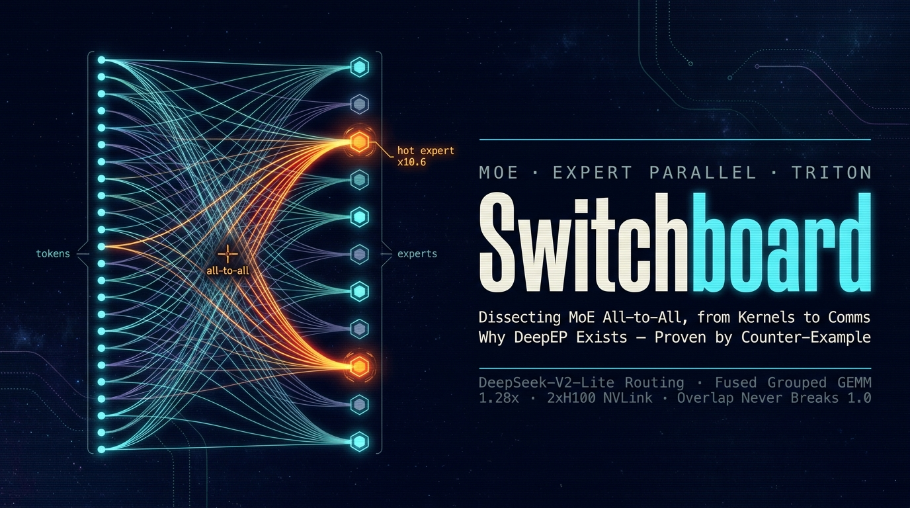

<!-- PROJECT LOGO -->
<div align="center">
  <a href="https://github.com/ChaoyuWang04/Switchboard_MoE-DeepEP">
    
  </a>

<h3 align="center">Switchboard</h3>

<p align="center">
  Bottom-up dissection of MoE expert parallelism — real routing-skew capture from DeepSeek-V2-Lite, hand-written fused grouped-GEMM Triton kernels, and two-phase all-to-all dispatch/combine with comm–compute overlap on 2×H100 — culminating in a boundary proof of why DeepEP exists.
  <br /><br />
  | <a href="https://github.com/ChaoyuWang04/Switchboard_MoE-DeepEP/issues/new?labels=bug">Report Bug</a> |
  <a href="https://github.com/ChaoyuWang04/Switchboard_MoE-DeepEP/issues/new?labels=enhancement">Request Feature</a> |
</p>

</div>

## About

Switchboard answers one question with original code and first-hand data: **what problem does DeepEP actually solve for Mixture-of-Experts?**

Instead of reading a tenth explainer, this project builds one MoE layer from scratch — from single-GPU expert kernels all the way to multi-GPU all-to-all communication — then runs head-on into DeepEP to find exactly where a hand-rolled implementation stops being enough. The metaphor behind the name: every token is a phone call, every expert an extension line, and dispatch/combine is the switchboard patching them through. The punchline: on a single NVLink node the switchboard is never the bottleneck — DeepEP was built for a different war.

The dataflow under study (shapes close the loop):

```text
x (T, H)
  ── replicate ×topk, sort by expert ──▶  send (T·k, H)
  ── all-to-all to expert ranks ──────▶  recv (E_local, cap, H)
  ── expert FFN (grouped GEMM) ───────▶  (E_local, cap, H)
  ── all-to-all back ─────────────────▶  (total, H)
  ── weighted sum by router score ────▶  out (T, H)
```

Hardware: RTX 5090 (sm_120) for Phases 0–1 · cloud 2×H100 NVLink for Phase 2. All numbers below are measured, not quoted.

## Phase 0 — Measure the Real Problem

Captured live routing decisions from **DeepSeek-V2-Lite** (64 experts, top-6) by monkeypatching its `route_tokens_to_experts` (forward hooks silently fail under accelerate offload — first pitfall of many).

- Load skew is severe and universal: **max/mean ≈ 10.6, CV ≈ 2.65, ~90% of experts are cold** — on every layer, not just a few
- Key realization: the auxiliary balance loss only guarantees *aggregate* balance over the training distribution — it promises nothing about per-batch balance at inference. This is exactly why MoE all-to-all is hard: buffers must be provisioned for the hottest expert

## Phase 1 — Make Single-GPU Expert Compute Fast

A six-version ladder where each version's measured weakness motivates the next (16,384 tokens, skew 1.5):

| Version | Speedup | What it killed | What it exposed |
|---|---|---|---|
| naive (per-expert loop) | 1.00× | — | skew → tiny 32×32 GEMMs starve tensor cores |
| torch_vec (argsort/bincount) | 1.18× | routing-lookup overhead | still one GEMM launch per expert |
| torch_bmm (pad-to-max) | **OOM** | small GEMMs | ~87% of compute is padding — a negative optimization |
| triton grouped GEMM v1 | 0.93× | small GEMMs *and* padding | O(E) scan inside the kernel |
| **fused (gate+up+SiLU)** | **1.28×** | redundant reads of x + standalone SiLU kernel | occupancy ~8.3% (open item) |
| fused + CUDA Graph | 1.23× | (hoped: launch gaps) | no gaps left to remove — replay copies cost more than they save |

Design points: tiles are allocated per *row-tile*, not per expert, so hot experts naturally take more tiles and cold ones take one (padding waste drops from ~3000 rows to <64); the per-tile expert table is precomputed on host with `searchsorted`, making the kernel-side lookup O(1); gate and up projections share one read of x with SiLU folded into the epilogue; block sizes autotuned.

## Phase 2 — Expert Parallelism, Then DeepEP

- `ep_reference` proves the distributed math first: dispatch → expert → combine matches direct single-device compute at **max_diff = 0**
- **3 all-to-alls reduced to 2**: send per-expert row counts as one "invoice", derive recv counts locally via a group-sum, regenerate per-token expert ids with `repeat_interleave` — the third all-to-all is redundant
- Plugged the Phase-1 fused kernel in as local expert compute — all randomized cross-checks pass, including non-uniform routing weights
- Chunked pipeline overlap: compute chunk *i* while chunk *i+1*'s all-to-all flies asynchronously
- Measured on 2×H100 (4096 tokens/rank): dispatch+combine **1.443 ms**, one dispatch **0.656 ms**, serial full layer **3.70 ms**

**The overlap result is the story**: speedup climbs monotonically with tokens from 0.47× to 0.96× but **never crosses 1.0**, and degrades monotonically with chunk count (0.99× → 0.75×). Root cause: on single-node NVLink, communication is only ~10% of layer time — there is almost no latency to hide — while every extra chunk pays NCCL's fixed per-call launch cost. And DeepEP itself **refuses to even initialize on this machine** (`Unable to dlopen libibverbs`): its low-latency path hard-requires NVSHMEM/IBGDA over InfiniBand.

That failure is the answer, not a bug:

> DeepEP exists for **cross-node, small-message, high-frequency** all-to-all — where per-call launch overhead dominates and inter-node bandwidth is far below NVLink. IBGDA lets the GPU initiate RDMA directly, no CPU on the critical path, driving the fixed cost of "starting one small transfer" toward zero — which is precisely what makes fine-grained overlap profitable there and unprofitable here.

Three counterintuitive findings, each earned with a profiler: **padding away small GEMMs made things 8× slower and OOM'd** · **CUDA Graphs gain ≈ bubble share, which can be zero** · **comm–compute overlap is a net loss on single-node NVLink**.

## Methodology

1. **Roofline first, nsys second, ncu last** — qualify compute/memory-bound, then find the bottleneck kernel on the timeline (stethoscope), then deep-dive only that kernel (microscope). Sweeping ncu across a whole run is slow and unfocused
2. **Reading nsys for bubbles**: a dense kernel row is healthy; every gap is the GPU waiting on CPU/NCCL
3. **Predictions are cheap, profiling is also cheap** — multiple confident predictions in this project (overlap will help, workload is memory-bound, graphs will help) were overturned by data. All logged, none hidden: see [docs/design_notes.md](docs/design_notes.md)

## Repository Layout

```text
Switchboard/
├── src/
│   ├── phase0_moe_literacy/      # routing capture, load-skew analysis (DeepSeek-V2-Lite)
│   ├── phase1_single_gpu_moe/    # naive → vectorized → grouped GEMM → fused Triton ladder
│   └── phase2_expert_parallel/   # ep_reference / 2-all2all / fused / overlap / DeepEP baseline
├── docs/
│   ├── design_notes.md           # full campaign log: predictions, failures, corrections
│   ├── 01_why_deepep.md          # the final answer
│   └── cloud_manual.md           # 2×H100 runbook
├── reference/                    # single-file MoE references; DeepEP/nvshmem cloned here (gitignored)
├── tests/                        # correctness cross-checks
└── ForChaoyu.md                  # first-person project retrospective (Chinese)
```

## Requirements

- Python 3.11+ · `uv`
- CUDA-matched PyTorch build (sm_120 needs the cu128 wheel index) + Triton
- Phase 0 additionally: `transformers` + ~16 GB VRAM for DeepSeek-V2-Lite in 8-bit
- Phase 2 cloud runs: 2+ GPUs with NCCL; the DeepEP baseline additionally needs Hopper + InfiniBand

## Usage

```sh
# Phase 1 — six-way correctness + speed ladder
python -m src.phase1_single_gpu_moe.bench --synthetic --tokens 16384 --skew 1.5

# Phase 1 — probes
python -m src.phase1_single_gpu_moe.probe_triton      # per-stage timing + block sweep
python -m src.phase1_single_gpu_moe.roofline_check    # compute/memory-bound triage
python -m src.phase1_single_gpu_moe.graph_compare     # CUDA Graph on fragmented vs fat kernels

# Phase 2 — local logic validation (gloo, multi-process on one GPU)
SINGLE_GPU=1 torchrun --nproc_per_node=2 -m src.phase2_expert_parallel.ep_dist_fused
SINGLE_GPU=1 torchrun --nproc_per_node=2 -m src.phase2_expert_parallel.ep_dist_overlap

# Phase 2 — cloud (real 2-GPU NCCL): serial vs overlap vs DeepEP
torchrun --nproc_per_node=2 -m src.phase2_expert_parallel.bench_cloud --tokens 4096 --chunks 4
# sweep tokens/chunks to reproduce the overlap break-even curves
for t in 2048 8192 32768 65536; do \
  torchrun --nproc_per_node=2 -m src.phase2_expert_parallel.bench_cloud --tokens $t --chunks 4; done
```

## Roadmap

- [x] Real routing capture + load-skew quantification (10.6× max/mean, CV 2.65)
- [x] Fused grouped-GEMM Triton kernel with autotune (1.28× over naive, zero small-GEMM, near-zero padding)
- [x] Two-phase all-to-all dispatch/combine, numerically equivalent to single-device (max_diff = 0)
- [x] Chunked comm–compute overlap + break-even sweeps on 2×H100
- [x] DeepEP boundary proof (single-node: won't init; overlap ≤ 1.0)
- [ ] Multi-node IB/RoCE head-to-head vs DeepEP — turn the counter-example into a direct proof
- [ ] Fix fused-kernel occupancy (~8.3%): recompute tile_expert per BLOCK_M to unlock the autotune space
- [ ] FP8 dispatch: how does halving traffic move the overlap break-even point?
- [ ] Kernel-level (not chunk-level) overlap via streams + events, DeepEP-hook style
- [ ] Controlled skew sweeps: connect Phase-0 imbalance directly to buffer waste and tile utilization
- [ ] End-to-end with real DeepSeek-V2-Lite expert weights, validated against the HF reference

## Contributing

Issues and pull requests are welcome. The highest-leverage areas:
- multi-node DeepEP comparison results on IB/RoCE clusters
- occupancy analysis of the fused grouped-GEMM kernel
- overlap break-even data from other interconnects (PCIe, RoCE, NVLink generations)

## Links

- Project: [https://github.com/ChaoyuWang04/Switchboard_MoE-DeepEP](https://github.com/ChaoyuWang04/Switchboard_MoE-DeepEP)
- Author: [Chaoyu Wang](https://www.linkedin.com/in/samwang04/)

## License

Distributed under the MIT License. See `LICENSE` for more information.
